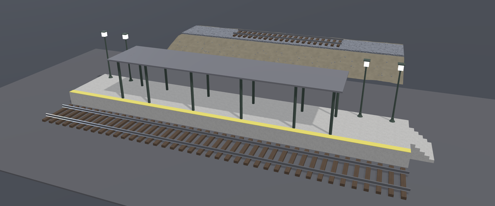
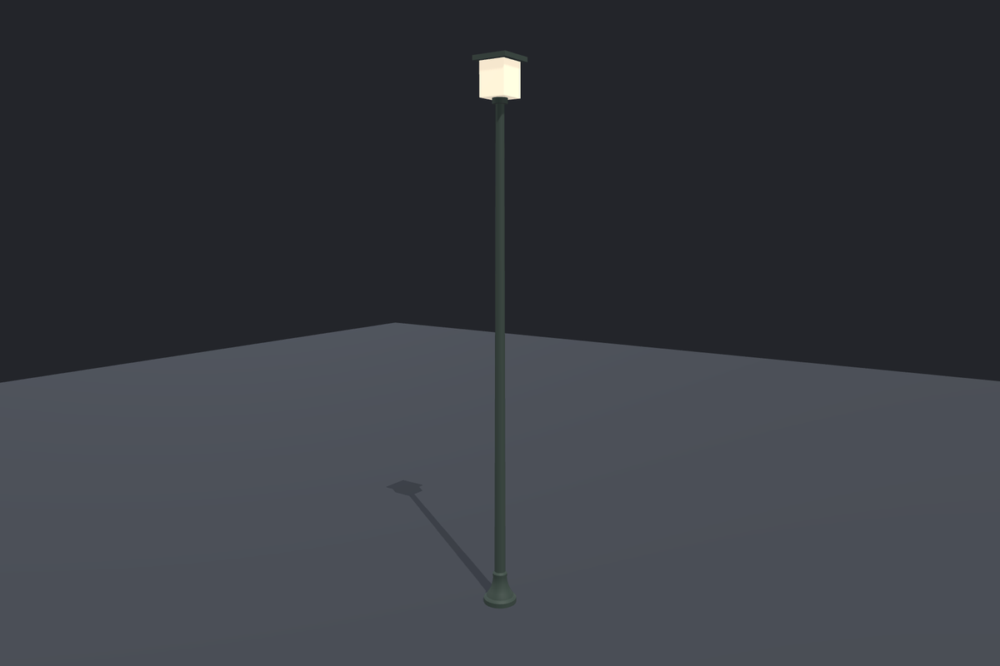
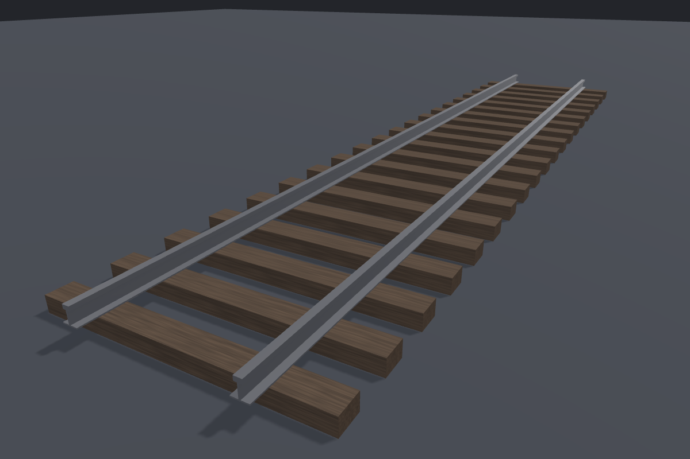
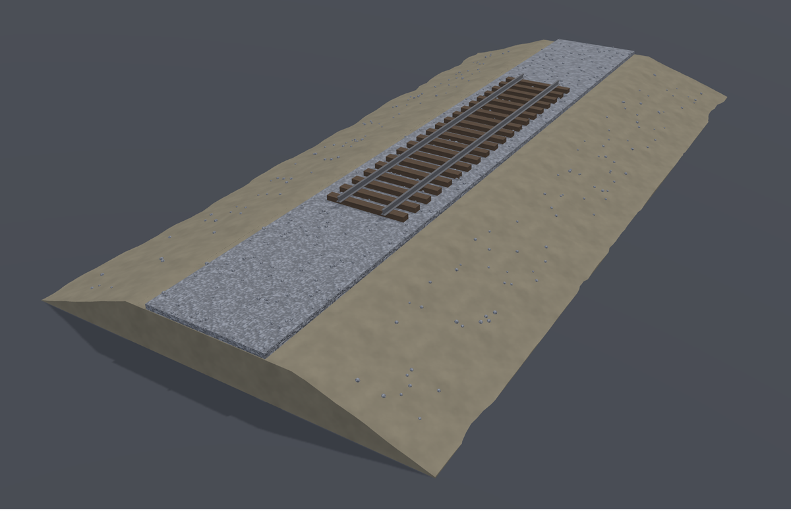
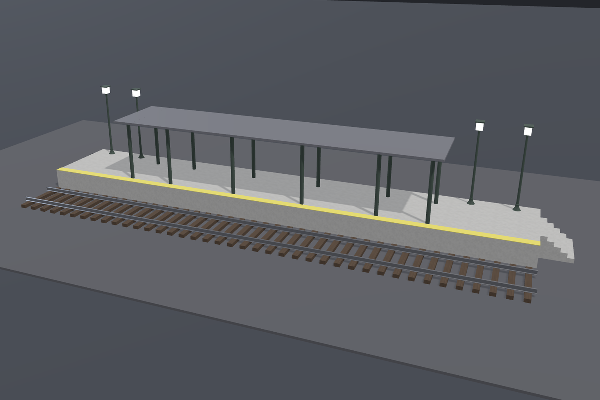
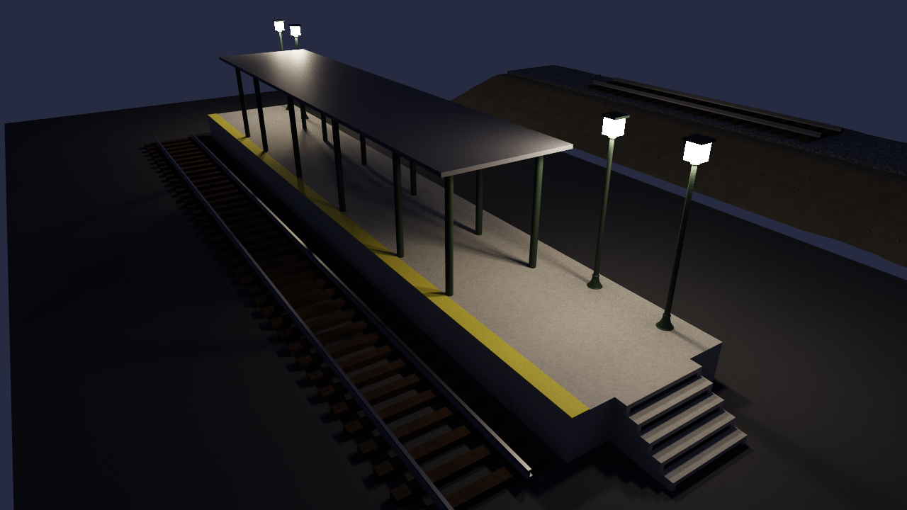

# Moraine sample workspace — a railway station kit

A small kit of real-time 3D assets built with
[Moraine](https://github.com/ms-elk/moraine) and an AI agent (Claude
Opus 5.5 in Claude Code). The human defined the requirements and
accepted or rejected each round. The agent wrote the recipes, and
Moraine validated the resulting geometry against the declared
requirements. The process is recorded, one commit per round.



## Explore the workspace

The workspace contains five projects. Each has a main recipe
(`<name>.star`), human-defined requirements
(`<name>.requirements.star`), and a `journal.md` recording decisions.
Projects reuse other projects by reference. Changes to a part
propagate to its consumers, which revalidate the referenced asset's
requirements under their own parameter overrides.

| Project | What it is | References | Knobs |
|---|---|---|---|
| [`lamp_post`](lamp_post/lamp_post.star) | A cast-iron platform lamp: turned base, shaft, collar, glass lantern, and cap | — | `shaft_length`, `glass_emissive` |
| [`track`](track/track.star) | A 12 m track panel with two rails and twenty instanced sleepers | — | `gauge` (1.000–1.676 m) |
| [`embankment`](embankment/embankment.star) | An earth bank with a ballast bed, 580 scattered stones, and a track panel | `track` | — |
| [`station`](station/station.star) | A platform with a safety band, a six-bay canopy, four lamps, two track panels, and a stair | `lamp_post`, `track`, [`canopy_bay`](station/subassets/canopy_bay.star) (local sub-asset) | — |
| [`scene`](scene/scene.star) | The station and embankment line, composed by placement only | `station`, `embankment` | — |

Human-defined requirements live in the requirements files. Recipes
use those values to construct assets, while validation measures the
resulting geometry against them. Agent-defined invariants remain in
the recipes. Values accepted in the viewer are saved separately in
`params.json` (see
[`lamp_post/params.json`](lamp_post/params.json)).

| | |
|---|---|
|  |  |
|  |  |

## What the history shows

Beyond the finished assets, the history shows where human judgment
guided the work alongside automated validation:

- **Visual feedback from the viewer.** The sleeper grain looked like
  flat stripes, and the ballast bed like a smooth slab. The human
  pinned each issue in the viewer and described it in a sentence.
  The agent revised the materials while preserving the material
  identities defined in [`AGENTS.md`](AGENTS.md).
- **A stair from a pin and a sentence.** In a fresh session opened
  in `station/`, the human pinned the platform and requested a
  stair. The agent built five instanced steps on two sawtooth
  stringers, with each step seated on both by at least 0.025 m² of
  contact area. The requirement was seated, not merely touching
  ([`station/journal.md`](station/journal.md)).
- **A requirement that failed.** After the canopy was re-pitched and
  recolored, the human required 0.50 m of clearance between each
  lantern and the roof. Two lamps had only 0.44 m. Rather than
  relaxing the requirement, the agent surfaced the conflict, and the
  human chose to move the lamps to x = ±11.
- **Changes through requirements.** Four standard canopy bays of
  3.5 m instead of three of 4.0 m, 1.0 m bays at each end, standard
  gauge on the embankment, and revised lamp positions: each change
  was made through constants in requirements files such as
  [`station/station.requirements.star`](station/station.requirements.star),
  with before-and-after values reported. Unaffected projects
  re-exported byte for byte.
- **A night variant without duplication.** The lantern's emissive
  color became a knob. The station overrides it by a factor of 100
  under the material identity `lamp_glass_night`, and the scene
  inherits the result through its references.
- **A parameter accepted in the viewer.** The human adjusted the
  lamp post's shaft length and pressed Accept, saving the value in
  `lamp_post/params.json`. The station remained unchanged because it
  overrides the shaft length itself: a consumer's override takes
  precedence over an accepted value.

Each project's `journal.md` records the reasoning behind decisions:
why the canopy stands forward of the lamps, why the steps are
thinner than their rise, how the sinking limit was measured on a
relief surface, and which alternatives were built and rejected.

## Run it

Install Moraine (Windows or macOS on Apple silicon, with Python 3.12
or later), clone the repository, and start the viewer:

```bash
uv tool install moraine3d
git clone https://github.com/ms-elk/moraine-sample-workspace.git
cd moraine-sample-workspace
moraine serve .
```

The viewer opens with a project picker and the knobs. Select
`lamp_post`, adjust *Shaft length*, and press Accept. The value
is saved to `lamp_post/params.json` as a one-line diff, and Moraine
revalidates the project at the new value.

To make further changes, open the workspace in your AI coding agent
and describe what you want. The agent follows [`AGENTS.md`](AGENTS.md)
and Moraine's shipped guide, edits the recipe, and validates the
result. You review it in the viewer, pin what needs refinement, and
accept or reject.

You can also validate every declared requirement yourself from the
workspace root:

```bash
moraine validate .
```

Exports are not committed; they are regenerated from the recipes. The
GLBs on the [releases page](https://github.com/ms-elk/moraine-sample-workspace/releases)
were produced with `moraine3d` 0.2.1 from a cleared cache, using
`moraine export` for each project. Under that version, fresh exports
match the published `SHA256SUMS` byte for byte.

## Rendering the exports

The exports use glTF 2.0, preserving materials and GPU instancing
(`EXT_mesh_gpu_instancing`).



*The exported scene, rendered at night with a path tracer.*

The station's lanterns use `KHR_materials_emissive_strength` with a
strength of 100. A renderer that supports the extension can
reproduce their emissive appearance; in this path-traced rendering,
they also illuminate the surrounding platform.

## How it was built

The kit was built in separate agent sessions, using only Moraine's
shipped guide ([`.moraine/guide.md`](.moraine/guide.md)),
`moraine docs`, and CLI `--help` as documentation.

The requests ([`docs/requests.md`](docs/requests.md)) were drafted in
advance with the agent used to develop Moraine, with the human
deciding each requirement. The human also defined the workspace
rules ([`AGENTS.md`](AGENTS.md), including the material table),
reviewed and accepted or rejected each round, and directed the agent
to commit the results.

The Moraine developer did not manually edit any recipes or
requirements files. Changes to the workspace rules were also made by
the agent, at the human's direction.

## License

Except for `.moraine/guide.md`, all contents of this repository and
the released models are dedicated to the public domain under CC0-1.0.
You may use them for any purpose without attribution.

The guide is part of Moraine, maintained by `moraine init`, and
licensed under Apache-2.0.
